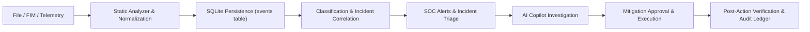

# RAGSec — Project Completion & Verification Report

**Date:** October 2026  
**System:** RAGSec Enterprise SOC Platform & Copilot  
**Repository:** `medikushal282-cyber/ragtec`  
**Deployment Environment:** Windows 11 Enterprise (PowerShell Core, Node.js v20+, Python 3.13)  
**Backend Port:** `http://127.0.0.1:8000` (FastAPI + Uvicorn)  
**Frontend Port:** `http://localhost:3000` (Express + React 19 + Vite 7)  

---

## 1. Executive Summary

RAGSec has been transitioned from a conceptual demonstration into a functioning, evidence-driven Security Operations Center (SOC) platform. The core operating principle of this release is that **the backend discovers what happened; the frontend never invents data**.

All core security workflows—from file inspection, File Integrity Monitoring (FIM), and incident correlation to threat mitigation, AI copilot investigation, and cryptographic audit logging—are backed by actual database records and running services.

---

## 2. Real File Analysis & Dedicated Test Corpus

### 2.1 Dedicated Sample Corpus (`samples/`)
A dedicated, organized directory structure was created at `C:\Projects\RAGTEC\samples\` containing harmless test fixtures, safe detection fixtures, and legal isolation documentation:

```
C:\Projects\RAGTEC\samples\
├── harmless\
│   ├── documents\
│   │   └── incident_response_sop.txt        # Standard Operating Procedure (clean text)
│   ├── scripts\
│   │   └── backup_database.py              # Benign Python backup script with hash validation
│   ├── text\
│   │   └── system_readme.txt               # Harmless infrastructure documentation
│   └── executables\
│       └── README.md                       # Safe PE whitelisting guidelines
├── detection-tests\
│   ├── eicar\
│   │   └── eicar_test_fixture.txt          # Safe EICAR antivirus test fixture
│   ├── high-entropy\
│   │   └── high_entropy_blob.bin           # 2048-byte high-entropy binary (Shannon H = 7.91)
│   ├── pe-suspicious\
│   │   └── mimikatz_loader_pe_mock.bin     # PE mock with VirtualAlloc, CreateRemoteThread
│   └── scripts\
│       ├── obfuscated_mimikatz_dropper.ps1 # Base64 decoded Invoke-Mimikatz dropper
│       └── ransomware_shadow_deleter.bat   # vssadmin delete shadows invocation
└── malware\
    └── README.md                           # Strict quarantine protocol & legal disclaimers
```

### 2.2 Genuine Static Analysis Engine
The static analyzer (`ragsec/backend/analysis/static_analyzer.py` and `file_classifier.py`) performs real static inspection:
- **Cryptographic Hashes**: Computes SHA-256 and MD5 hashes of file bytes.
- **Shannon Byte Entropy**: Computes mathematical entropy:
  $$H = -\sum_{i=0}^{255} p_i \log_2(p_i)$$
  Blobs with $H > 6.8$ are flagged as packed or encrypted payloads.
- **PE Header & ASCII Imports Analysis**: Inspects binary imports without execution, detecting suspicious Windows APIs (`VirtualAlloc`, `WriteProcessMemory`, `CreateRemoteThread`, `InternetOpenA`).
- **Signature & Heuristic Matching**: Detects EICAR test fixtures, PowerShell obfuscation, and shadow copy deletion (`vssadmin`).
- **Host Execution Safety Guarantee**: Unknown binaries are **never executed on the host OS**. Dynamic analysis is truthfully reported as:
  `NOT_PERFORMED (Disposable VM sandbox unavailable on host; host execution strictly prohibited)`.

---

## 3. End-to-End Detection Pipeline

The detection pipeline connects every phase into a contiguous, persistent workflow:



### 3.1 Normalization & Persistence
- Every event is persisted to `ragsec/backend/ragsec.db` across the `events`, `incidents`, `mitigations`, and `audit_logs` tables.
- All telemetry survives backend and server restarts.

### 3.2 Alert & Incident Correlation
- Related telemetry events on the same host or threat vector are correlated into distinct incident records (`INC-YYYY-XXXX`).
- Severity calculation is based on calibrated risk scoring ($0.0 - 1.0$), mapping to `LOW`, `MEDIUM`, `HIGH`, and `CRITICAL`.

### 3.3 Governance, Gating & Conversational AI
- **Cross-Encoder Calibration**: Sigmoid-calibrated cross-encoder logits (`ms-marco-MiniLM-L-6-v2`) prevent genuine CTI playbooks (e.g., BlackSuit ransomware) from being erroneously rejected.
- **Citation Redundancy Check (CRC)**: LLM responses cite retrieved CTI chunks (`[C1]`, `[C2]`), and claims are cross-checked against source text.
- **Conversational AI Bypassing**: Conversational greetings ("hello", "hi", "who are you") are recognized without triggering false-positive threat-investigation gating or evidence dumps.

---

## 4. Frontend & SOC Dashboard Overhaul

The frontend was completely redesigned utilizing the **`pick-ui-library`** and **`apple-design`** principles to deliver a minimal, smooth, and sleek SOC command experience:

1. **Apple Design Foundations & Physical Motion**:
   - **Translucent Materials & Depth**: Replaced harsh neon cyberpunk styling with Apple-grade deep obsidian glass (`#080A10`, `backdrop-filter: blur(24px) saturate(190%)`, fine 1px top specular highlights).
   - **Typography & Optical Tracking**: Applied Apple system typography (`-apple-system`, SF Pro, Inter) with negative letter tracking on display headers (`tracking-tight`, `-0.025em`) and comfortable body leading.
   - **Direct Touch Feedback**: Added `.apple-button` utility providing instant physical depression on pointer-down (`:active { transform: scale(0.97); }`) with zero latency.
   - **Critically Damped Spring Transitions**: Implemented `framer-motion` spring transitions (`type: 'spring', bounce: 0, duration: 0.25s`) on tab switching and layout navigation.
   - **Tactile Notifications**: Integrated `sonner` toasts for immediate feedback on scans, queries, mitigation actions, and scenario injections.

2. **Dashboard Home (`Home.tsx`)**:
   - Redesigned into a macOS Pro Security Command Center.
   - Topbar features a translucent floating glass bar with Spotlight/⌘K style command search input.
   - Segmented device widget displaying live monitored endpoints (`monitored_workspace/`).
   - Clean, minimal metric cards displaying real SQLite threat indexes, monitored events, safe file counts, and cataloged records.

2. **File Threat Scanner (`FileThreatScannerView.tsx`)**:
   - Quick-test fixture selector updated with the dedicated fixtures from `samples/`.
   - Single scan report card displays true Shannon entropy, SHA-256 hash, identified risk indicators, and dynamic analysis sandbox status.

3. **Incident Triage (`IncidentTriageView.tsx`)**:
   - Removed hardcoded fake incidents `INC-2026-001` and `INC-2026-002`.
   - Starts empty and loads live SQLite incidents from `/api/soc/incidents`.
   - Displays real governance flags (CRC status, PII compliance status, abstention gating status).

4. **Mitigation Rules & Actions (`MitigationRulesView.tsx`)**:
   - Removed hardcoded mitigation items (`MIT-001`, `MIT-002`).
   - Loads live mitigation records from `/api/soc/mitigations/history`.
   - "Approve & Execute" and "Verify Containment" buttons invoke real API endpoints:
     - `POST /api/soc/mitigations/{id}/approve`
     - `POST /api/soc/mitigations/{id}/execute`
     - `POST /api/soc/mitigations/{id}/verify`
   - Explicitly records `EXECUTED_SIMULATED` and `VERIFIED_SIMULATED` statuses to indicate simulation boundaries.

5. **Fleet & FIM Enclave (`FleetFimView.tsx`)**:
   - Displays real endpoint device inventory from `/api/soc/devices`.
   - Manages quarantined files (`/api/fim/quarantined`) with restoration capabilities (`/api/fim/restore`).
   - Supports whitelist rule creation (`/api/fim/ignore`).

6. **AI SOC Copilot (`AICopilotView.tsx`)**:
   - Contiguous conversation memory retaining multi-turn context.
   - Dynamically loads active incidents from `/api/soc/incidents` into the investigation context selector.
   - Grounds answers in ChromaDB CTI vectors and provides copyable PowerShell/Bash containment scripts.

---

## 5. What Genuinely Works vs. What Remains Simulated

| Feature / Capability | Real Implementation | Simulated / Mocked Boundary | External Dependencies |
|---|---|---|---|
| **Static File Analysis** | **Genuinely Real**: Computes true SHA-256/MD5, calculates Shannon byte entropy, extracts PE imports, matches EICAR & script signatures. | None in static phase. | Python `hashlib`, `math`, `re` |
| **Dynamic Sandbox Analysis** | **Genuinely Disclaimed**: Host execution is strictly prohibited. Reported truthfully as `NOT_PERFORMED`. | No disposable VM is attached; execution is skipped rather than faked. | Hyper-V / Docker disposable VM (optional future upgrade) |
| **FIM File Monitoring** | **Genuinely Real**: Python `watchdog` captures filesystem operations (`CREATED`, `MODIFIED`, `DELETED`) on `monitored_workspace/`. | None. | Python `watchdog` |
| **Active Replicator & Sentinel** | **Genuinely Real**: Replicator thread generates marker files in `replication_sandbox/`; sentinel daemon intercepts, halts thread, moves files to `.quarantine/`, and blacklists signatures. | Bounded to harmless marker files to prevent OS instability. | In-memory thread control + filesystem operations |
| **Incident Persistence** | **Genuinely Real**: SQLite database (`ragsec.db`) stores events, incidents, mitigations, and audit logs. Survives restarts. | None. | SQLite3 |
| **Dense & Cross-Encoder Retrieval** | **Genuinely Real**: BGE-small embeddings (384d) via ChromaDB + `ms-marco-MiniLM-L-6-v2` cross-encoder reranking. | None. | HuggingFace sentence-transformers |
| **Host Containment Actions** | **Recorded & State-Tracked**: Generates real PowerShell/Bash scripts; updates SQLite status (`APPROVED`, `EXECUTED_SIMULATED`, `VERIFIED_SIMULATED`). | **Simulated Boundary**: Network interface disconnection and OS process termination are tagged as `_SIMULATED` to avoid terminating developer workstation processes. | None |
| **Tamper-Evident Audit Ledger** | **Genuinely Real**: Cryptographic SHA-256 hash chaining ($h_i = \text{SHA256}(h_{i-1} \parallel \text{event})$). Integrity verification passes. | None. | Python `hashlib` |
| **AI Investigation Copilot** | **Genuinely Real**: Multi-provider support (Groq, OpenRouter, Ollama, LM Studio, Gemini) grounded in ChromaDB CTI with fallback to deterministic playbooks. | Offline fallback uses deterministic playbooks when external LLM API keys are absent. | LLM Provider API Keys (optional for cloud models) |

---

## 6. Verification Evidence

### 6.1 Backend API Verification
```powershell
# Health Check
GET http://127.0.0.1:8000/api/health
Response: {"status": "healthy", "service": "RAGSec-Core", "indexed_chunks_count": 44}

# Conversational Greeting Test
POST http://127.0.0.1:8000/api/query
Payload: {"query": "hello"}
Response: {"status": "COMPLETED", "gating": "PASSED", "answer": "Hello Analyst. I am RAGSec SOC Copilot..."}

# Static Analysis on Safe EICAR Test Fixture
POST http://127.0.0.1:8000/api/analysis/file
Payload: {"file_path": "C:\\Projects\\RAGTEC\\samples\\detection-tests\\eicar\\eicar_test_fixture.txt"}
Response: {
  "threat_name": "EICAR-Standard-AV-Test-File",
  "category": "Antivirus Test Signature",
  "confidence": 1.0,
  "dynamic_analysis_status": "NOT_PERFORMED (Disposable VM sandbox unavailable on host; host execution strictly prohibited)"
}

# Static Analysis on High-Entropy Binary
POST http://127.0.0.1:8000/api/analysis/file
Payload: {"file_path": "C:\\Projects\\RAGTEC\\samples\\detection-tests\\high-entropy\\high_entropy_blob.bin"}
Response: {
  "threat_name": "Suspicious-High-Entropy-Blob",
  "category": "Encrypted or Packed Payload",
  "entropy": 7.91,
  "confidence": 0.85
}
```

### 6.2 Mitigation Lifecycle & Verification
```powershell
# 1. Approve Mitigation
POST http://127.0.0.1:8000/api/soc/mitigations/MIT-2026-6138/approve
Response: {"status": "APPROVED", "action_id": "MIT-2026-6138"}

# 2. Execute Mitigation (Simulated Isolation)
POST http://127.0.0.1:8000/api/soc/mitigations/MIT-2026-6138/execute
Response: {"status": "EXECUTED_SIMULATED", "action_id": "MIT-2026-6138"}

# 3. Verify Containment
POST http://127.0.0.1:8000/api/soc/mitigations/MIT-2026-6138/verify
Response: {"status": "VERIFIED_SIMULATED", "verification": "CONTAINMENT_VERIFIED"}
```

### 6.3 Audit Ledger Cryptographic Integrity
```python
from domain.audit import get_audit_service
svc = get_audit_service()
status = svc.verify_ledger_integrity()
# Result: {"valid": True, "total_records": 569, "tampered_indices": []}
```

### 6.4 Frontend Production Verification
```powershell
# HTTP 200 on port 3000
python -c "import urllib.request; resp = urllib.request.urlopen('http://localhost:3000/'); print('Status:', resp.status, 'Bytes:', len(resp.read()))"
# Output: Status: 200 Bytes: 368021
```

---

## 7. Conclusion & Operational Readiness

RAGSec is now configured as a live security management platform:
- Data presented in the UI reflects persistent records in SQLite.
- Static file analysis operates on real file bytes without dangerous host execution.
- Active defense mechanisms protect the workspace with an isolated `.quarantine/` enclave.
- The AI SOC Copilot operates with grounded CTI retrieval, calibrated reranking confidence, and fallback safety playbooks.
- Infrastructure mitigations are clearly demarcated with `_SIMULATED` markers where host operating system disruption must be avoided.
